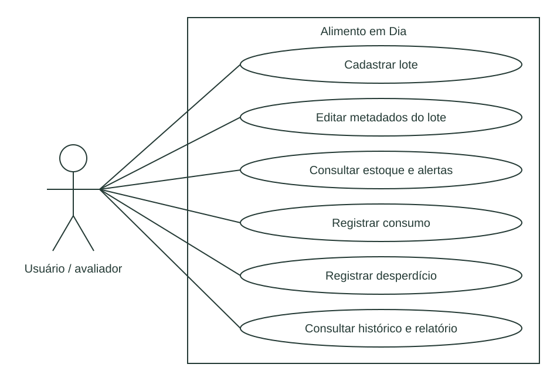
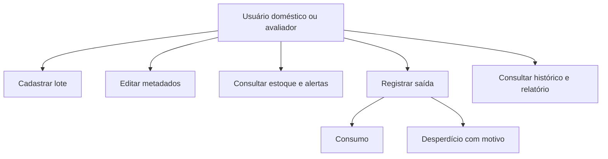
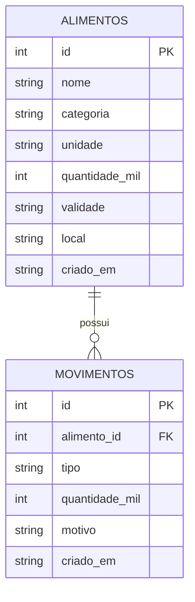
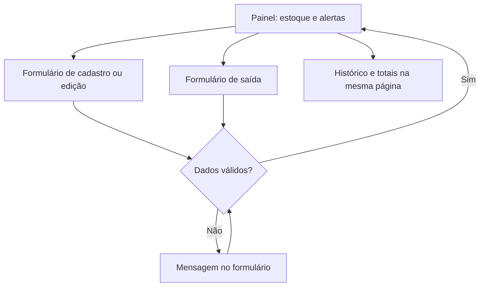

# Diagramas complementares

Os blocos Mermaid podem ser visualizados no GitHub. Os diagramas de classes, sequência e atividade estão em projeto.md.

## Casos de uso UML

O ator interage com seis casos de uso dentro do limite do sistema. Desperdício exige motivo como regra de validação.

## Mapa funcional complementar

Este fluxograma representa o ator e as funcionalidades; não usa a notação gráfica formal de casos de uso UML.

| Caso | Pré-condição | Resultado / exceção |
|---|---|---|
| Cadastrar lote | Formulário aberto | Novo lote; rejeita campos inválidos |
| Editar lote | Lote existente | Metadados atualizados; unidade imutável |
| Consultar | Página aberta | Busca, filtro e alertas |
| Registrar saída | Lote com saldo | Saldo reduzido e histórico; rejeita excesso |
| Consultar relatório | Página aberta | Totais separados por unidade e histórico |

## Entidades e relacionamentos

## Navegação e mensagens

Cancelar retorna ao painel sem gravação. Durante envio o botão fica desativado. Saldo insuficiente mostra mensagem e preserva o estoque; desperdício exige motivo. O código da interface em static/ é o protótipo funcional. Não foi realizado estudo formal de usabilidade.
