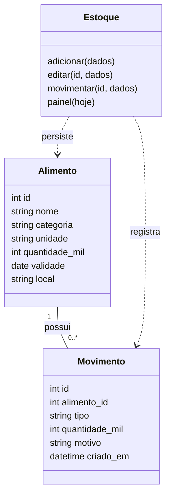
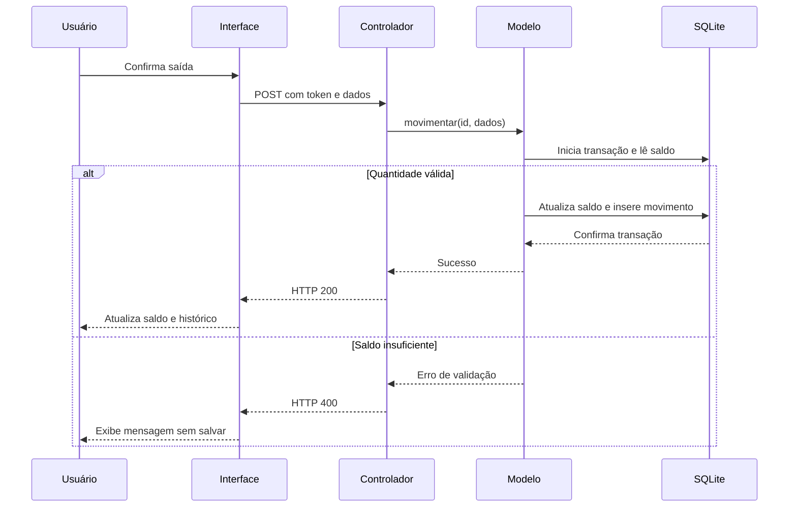
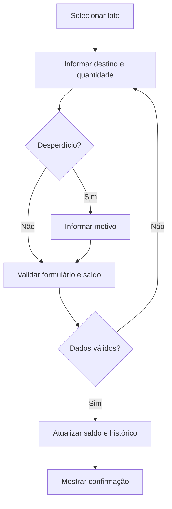

# Alimento em Dia: sistema de controle de alimentos e validade

Estudante: Jessica • RGM: 39390934
Disciplina: Projeto Integrador Transdisciplinar em Engenharia de Software II
Versão para publicação: 04/11/2026. Confirmar nome acadêmico completo, instituição, turma e dados de capa antes da entrega.

## 1. Contexto e objetivo

A proposta é apoiar o controle doméstico de alimentos, tornando visíveis as quantidades disponíveis e a proximidade da validade. O sistema registra entradas como lotes, saídas por consumo e desperdício e apresenta um histórico. A redução efetiva de desperdício é uma hipótese de benefício, não um resultado medido nesta versão.

Este é um projeto novo; não foi apresentado como revisão de um trabalho anterior. A autorização para substituir o tema do Projeto Integrador I está pendente. Não foram realizadas entrevistas, pesquisas de campo nem avaliações humanas até esta versão.

## 2. Escopo e requisitos

| ID | Requisito | Critério de aceitação |
|---|---|---|
| RF01 | Cadastrar lote | Nome, categoria, unidade, quantidade positiva, validade e local ficam salvos após reiniciar. |
| RF02 | Editar metadados | Corrigir nome, categoria, validade e local sem alterar saldo ou unidade. |
| RF03 | Consultar estoque | Buscar por nome, filtrar situação e ordenar pela validade. |
| RF04 | Alertar validade | Classificar em vencido, vence em breve (0–3 dias), no prazo ou esgotado. |
| RF05 | Registrar consumo | Deduzir quantidade do lote e criar histórico na mesma transação. |
| RF06 | Registrar desperdício | Exigir motivo, deduzir saldo e criar histórico. |
| RF07 | Consultar relatório | Somar consumo/desperdício separadamente por kg, L e un. |
| RF08 | Consultar histórico | Mostrar data, alimento, destino, quantidade e motivo. |

Requisitos não funcionais: interface em português; uso com teclado e rótulos; execução local sem dependências externas; modo hospedado via WSGI; mensagens de erro compreensíveis; persistência SQLite; separação MVC; consultas SQL parametrizadas; integridade referencial e transações. A interface possui CSS responsivo, mas sua validação visual em Safari/Mac ainda deve ser feita.

Fora do escopo: usuários e autenticação, código de barras, previsão de consumo, integração com supermercados, estorno, notificações externas e cálculo de dinheiro economizado.

## 3. Regras de negócio

Um lote reúne alimento, unidade, local e validade. Compras com outra validade geram outro lote. Quantidades são armazenadas como inteiros em milésimos, evitando erros de arredondamento binário: 1,25 kg corresponde a 1250. Valores aceitos: maiores que zero, no máximo 100000 e até três casas decimais por operação. A unidade permanece imutável após o cadastro. O saldo pode chegar a zero, mas nunca ficar negativo. Desperdício exige motivo de 1 a 200 caracteres.

O sistema aceita cadastrar um lote vencido, pois o usuário pode precisar registrar estoque existente e seu posterior descarte. Um alerta de data não é garantia de segurança alimentar. “No prazo” significa apenas que a validade cadastrada está a mais de três dias da data local.

## 4. Modelagem conceitual e UML

Ator: usuário doméstico. Casos de uso: cadastrar lote, editar lote, consultar estoque/alertas, registrar consumo, registrar desperdício, consultar relatório e histórico. Todos são acessíveis ao usuário; não há contas. Na demonstração online, todos os visitantes compartilham o mesmo estoque.

### Classes de domínio

As classes Alimento e Movimento representam entidades conceituais. Na implementação Python, suas instâncias são linhas do SQLite convertidas em dicionários, e Estoque concentra as operações do modelo.

### Sequência da baixa

### Atividade: registrar saída

## 5. Projeto lógico e físico

ALIMENTOS(id PK, nome, categoria, unidade, quantidade_mil, validade, local, criado_em).
MOVIMENTOS(id PK, alimento_id FK → ALIMENTOS.id, tipo, quantidade_mil, motivo, criado_em).
Relacionamento um-para-muitos; movimentos dependem de um alimento existente.

Cada linha tem chave primária simples e campos atômicos. Os atributos descritivos dependem do identificador da sua tabela; o nome e a unidade não são repetidos em movimentos, sendo obtidos por JOIN. Categoria e local são domínios controlados pela aplicação. O modelo busca a terceira forma normal, mantendo o saldo como valor materializado para facilitar consultas; sua consistência é mantida pela transação de baixa. Não existe uma tabela de produtos separada porque cada cadastro representa um lote doméstico independente.

O projeto físico está em `schema.sql`, executado na inicialização. SQLite aplica PK, FK, NOT NULL, CHECK de unidade, tipo e quantidades. A aplicação valida a data e os domínios de categoria/local antes da gravação. Há índices de validade e de referência do movimento ao alimento.

### Dicionário de dados

| Tabela.campo | Tipo físico | Significado e restrição |
|---|---|---|
| alimentos.id | INTEGER | Chave primária gerada pelo SQLite. |
| alimentos.nome | TEXT | Nome obrigatório, 1–80 caracteres após remover espaços extremos. |
| alimentos.categoria | TEXT | Uma das seis opções do formulário, validada no modelo. |
| alimentos.unidade | TEXT | un, kg ou L; imutável pela edição. |
| alimentos.quantidade_mil | INTEGER | Saldo em milésimos; maior ou igual a zero. |
| alimentos.validade | TEXT | Data ISO AAAA-MM-DD validada pela aplicação. |
| alimentos.local | TEXT | Geladeira, Congelador ou Despensa. |
| alimentos.criado_em | TEXT | Timestamp UTC gerado na inserção. |
| movimentos.id | INTEGER | Chave primária. |
| movimentos.alimento_id | INTEGER | Chave estrangeira obrigatória para alimentos.id. |
| movimentos.tipo | TEXT | consumo ou desperdicio. |
| movimentos.quantidade_mil | INTEGER | Quantidade positiva em milésimos. |
| movimentos.motivo | TEXT | Obrigatório para desperdício na aplicação; vazio para consumo. |
| movimentos.criado_em | TEXT | Timestamp UTC gerado na inserção. |

## 6. Arquitetura e interface

O navegador apresenta HTML/CSS e usa JavaScript para buscar o painel e enviar os formulários. `app.py` (local) ou `wsgi.py` (hospedado) valida o caminho, o token e o formato das requisições, delegando a `Estoque`. O modelo valida regras e executa SQL. A resposta JSON atualiza a visualização. A aplicação não usa frameworks externos.

A tela principal contém resumo de lotes ativos, alertas, busca/filtro, tabela de estoque, relatório por unidade e histórico. Dois formulários modais atendem cadastro/edição e saída. Cancelar fecha sem gravar. Os botões de envio são desativados durante a requisição para evitar duplo clique. Erros aparecem no formulário; campos e alertas têm rótulos e regiões acessíveis. Conteúdo digitado pelo usuário é inserido na página por `textContent`.

## 7. Verificação e validação

Foram executados 16 testes automáticos em Python 3.12 no ambiente de desenvolvimento, com sucesso. O registro está em `resultado_testes.txt`. Incluem persistência, regras de saldo, limites de datas, campos inválidos, unidades, motivo obrigatório, edição, rotas HTTP, token e restrição de arquivos.

A sintaxe de `static/app.js` também foi verificada com `node --check`. Isso não comprova interação em navegador, acessibilidade completa, compatibilidade no Mac nem aprovação por usuários. A estudante confirmou uso local no Mac e forneceu uma captura da página hospedada aberta. Acessibilidade completa e compatibilidade em outros navegadores permanecem pendentes.

Plano manual: cadastrar lote; fechar/reabrir e conferir; editar validade; pesquisar; testar data de hoje e três dias à frente; consumir; tentar exceder o saldo; desperdiçar sem e com motivo; conferir histórico/relatório; testar teclado e janela estreita. Registre resultado real e evidência de cada cenário.

## 8. Avaliação por cinco pessoas e melhorias

Utilizar o formulário fornecido com cinco colegas de curso ou profissionais da área. Cada pessoa deve efetivamente operar o sistema e registrar data, funcionalidades que funcionaram/não funcionaram e funcionalidades não testadas, com justificativas. Comentários e prints devem refletir o uso real. Consolide em PDF e mantenha as respostas originais.

Após coleta, priorize problemas, implemente correções pertinentes e preencha `registro_melhorias.md`, associando cada mudança ao feedback recebido. Nenhuma resposta ou melhoria oriunda de usuários foi simulada nesta versão.

## 9. Entregas e fontes

Código, esquema SQL, documentação, testes, manual e modelos estão neste pacote. Permanecem pendentes avaliações reais, PDF de avaliações, eventuais correções e vídeo narrado pela estudante. O documento-base contém orientações contraditórias de vídeo (até cinco minutos e pelo menos cinco minutos); planejar cinco minutos e confirmar no AVA.

Referências: material fornecido “Projeto Integrador Transdisciplinar em Engenharia de Software II”, Artur Marques; documentação oficial SQLite/Python: https://docs.python.org/3/library/sqlite3.html; Python para macOS: https://www.python.org/downloads/macos/.

## 10. Implantação de 04/11/2026

O controlador WSGI usa o mesmo modelo, esquema SQL e interface da versão local. A configuração distribuída separa o controlador (`wsgi.py`) do arquivo de entrada do provedor (`pythonanywhere_wsgi.py`). Na instalação realizada por orientação na conversa, o controlador foi colado diretamente no arquivo do provedor; as rotas e regras são equivalentes.

O banco hospedado é independente do banco local. Não há autenticação: qualquer visitante pode alterar os dados da demonstração. O token evita requisições de gravação sem o token da página; não identifica o usuário nem restringe o acesso ao estoque. A aplicação serve apenas três arquivos estáticos autorizados. Não se destina a armazenar dados pessoais ou estoque confidencial.

Os alertas usam a data do servidor (que pode diferir do fuso do visitante); os horários gravados no banco são UTC. Os formulários de avaliação não são servidos pela aplicação e devem ser enviados separadamente.
